<div align="center">

# OfferSheet

### Know the number before you sign.

**An agentic offer checker for independent promoters, powered by Qloo taste intelligence. Every claim comes with a receipt you can replay.**

[](https://github.com/mohamedwael201193/OfferSheet/actions/workflows/ci.yml)
[](LICENSE)


**[▶ Live demo](https://offersheet-rouge.vercel.app)** · **[Open the app](https://offersheet-rouge.vercel.app/app.html)** · **[Backend health](https://offersheet-backend-k2zp.onrender.com/api/health)** · **[⬇ Android APK](https://github.com/mohamedwael201193/OfferSheet/releases/download/android-app-v1.0.0/offersheet-release.apk)**

### ▶ Watch the 3-minute demo

https://github.com/user-attachments/assets/a72da1a2-6b4e-4ae4-8a21-dee4ca38797d

**[▶ Watch the 3-minute demo on YouTube](https://www.youtube.com/watch?v=hJfhIayYv-w)** · [Play the mp4 on GitHub](https://github.com/mohamedwael201193/OfferSheet/blob/main/docs/media/offersheet-demo.mp4) · [Poster](docs/media/offersheet-demo-poster.jpg)

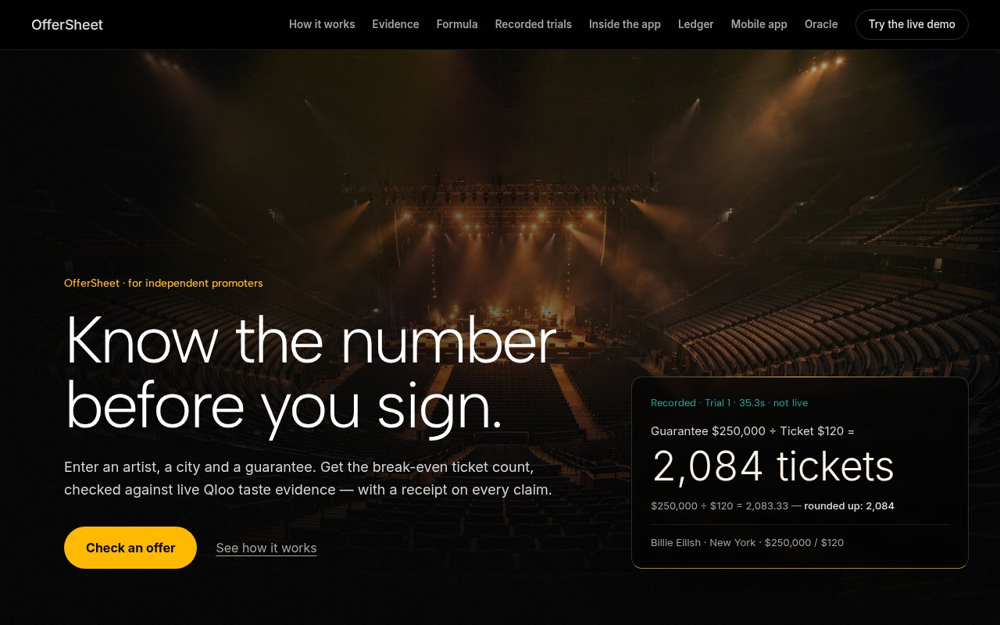

</div>

---

## The pitch

An independent promoter gets an offer: *book this artist, in this city, for this guarantee.* They have to decide fast, usually on gut feel, with real money at stake. OfferSheet turns that into one page and one number. Enter an artist, a city and a guarantee, and you get the **break-even ticket count**. Around it you get the **Qloo audience evidence**: opener shortlist, where the audience is, demographics, shared tags and fan overlap. A **three-arm race** puts Qloo's pick next to an LLM-only "gut" pick and an LLM + Wikidata "web" pick, and names every miss. Every Qloo-backed claim carries a **SHA-256 receipt** that you can click to re-run the exact call. There is no sign-in and no mock data. If a source is down, the page **fails closed** with a visible state instead of inventing a number.

> Design principle: Qloo affinities are aggregate taste signals. They are evidence, not a prediction. OfferSheet never renders a sellout percentage, a headcount or a causal claim, and it never invents a number.

---

## Contents

- [Verify every number yourself (for judges)](#-verify-every-number-yourself-for-judges)
- [Architecture](#-architecture)
- [Qloo depth: 10 of 10 official MCP tools](#-qloo-depth-10-of-10-official-mcp-tools)
- [OfferSheet MCP server: 33 tools](#-offersheet-mcp-server-33-tools)
- [Tour by tab](#-tour-by-tab)
- [Android app](#-android-app)
- [Run it locally](#-run-it-locally)
- [Tech stack](#-tech-stack) · [Project structure](#-project-structure) · [License](#-license)

---

## ✅ Verify every number yourself (for judges)

Each number below was measured against the live deployment on 30 Oct 2026. Re-run any of them with nothing more than `curl`, `node` and `sha256sum`.

### 1. The backend is live and every source is configured

```bash
curl -s https://offersheet-backend-k2zp.onrender.com/api/health
# {"status":"ok","version":"0.1.0","qlooConfigured":true,"ticketmasterConfigured":true,"llmConfigured":true}
```

### 2. The break-even number: trial 1

The formula ([`backend/src/breakeven.js`](backend/src/breakeven.js)):

```
tickets = ceil( (guarantee + entered fixed costs − entered sponsor offset) / (ticket price − variable cost per ticket) )
```

A blank field is left out, never treated as zero.

| Input | Arithmetic | Tickets |
|---|---|---|
| Billie Eilish · New York · guarantee $250,000 · ticket $120 | ceil(250,000 / 120) = ceil(2,083.33) | **2,084** |
| same + venue cost $10,000 | ceil(260,000 / 120) = ceil(2,166.67) | **2,167** |

Run both live:

```bash
B=https://offersheet-backend-k2zp.onrender.com

curl -s -X POST $B/api/verdict -H 'Content-Type: application/json' \
  -d '{"artist":"Billie Eilish","city":"New York","guarantee":250000,"ticketPrice":120}' \
  | tee verdict.json | node -e 'const d=JSON.parse(require("fs").readFileSync(0));console.log(d.breakEven.tickets, d.receipts.length+" receipts")'
# 2084 9 receipts

curl -s -X POST $B/api/verdict -H 'Content-Type: application/json' \
  -d '{"artist":"Billie Eilish","city":"New York","guarantee":250000,"ticketPrice":120,"roomCost":10000}' \
  | node -e 'console.log(JSON.parse(require("fs").readFileSync(0)).breakEven.tickets)'
# 2167
```

A full live verdict makes real Qloo, Ticketmaster and LLM calls. Measured end to end on 30 Oct 2026: 24.2 s and 36.1 s. The three recorded trials took 26.2 to 40.1 s.

### 3. Receipts: recompute the SHA-256 and replay the exact call

Every receipt carries an `operation`, a `requestHash`, a `requestId` and a `resultCount`, plus a `replay` object.

- MCP receipts hash `tool + " " + JSON(args)`.
- REST receipts hash `METHOD + " " + URL`.
- When Qloo returns no `requestId`, it is shown as `null`. It is never invented.

```bash
# a. Recompute the hash of the "headliner tags" receipt from the verdict above
printf '%s' 'qloo_find_tags {"query":"Billie Eilish","limit":10}' | sha256sum
# affa6e35703be8f54ddeec84c42966a06093e94f21082f4cd446ada31f7f93f7  ← equals receipts[1].requestHash

# b. Replay that exact call live
node -e 'const d=require("./verdict.json");process.stdout.write(JSON.stringify(d.receipts[1].replay))' > replay.json
curl -s -X POST $B/api/replay -H 'Content-Type: application/json' -d @replay.json | head -c 300
# {"kind":"mcp","tool":"qloo_find_tags","envelope":{...,"status":"ok",...},"requestHash":"affa6e35…","resultCount":10}
```

In the app, every receipt row has a **Replay** button that does the same thing.

### 4. Offline replay pack: no network, no keys

[`frontend/trial-pack.json`](frontend/trial-pack.json) holds the three recorded trials, each with its own SHA-256 and a pack hash. Verify it with the MCP server, without calling Qloo:

```bash
printf '%s\n' \
 '{"jsonrpc":"2.0","id":1,"method":"initialize","params":{"protocolVersion":"2024-11-05","capabilities":{},"clientInfo":{"name":"judge","version":"1"}}}' \
 '{"jsonrpc":"2.0","id":2,"method":"tools/call","params":{"name":"offersheet_trial_pack_verify","arguments":{}}}' \
 | node backend/mcp-server.js 2>/dev/null | tail -1
# ..."status":"ok","allPassed":true,"trialsChecked":3, ... "ceil(250000/120) = 2084" ...
```

The recorded trials come from the committed ledger [`bench/results.json`](bench/results.json). They are labelled *recorded, not live* wherever they appear.

| Trial | Inputs | Break-even | Qloo (Graph) pick | Gut (LLM-only) pick | Web (LLM + Wikidata) pick |
|---|---|---|---|---|---|
| 1 | Billie Eilish · New York · $250,000 / $120 | 2,084 | Olivia Rodrigo | Clairo | Armani White |
| 2 | Taylor Swift · New York · $250,000 / $120 | 2,084 | Carly Rae Jepsen | Sabrina Carpenter | Def Leppard |
| 3 | Olivia Rodrigo · Los Angeles · $180,000 / $95 | 1,895 | King Princess | Gracie Abrams | declined to pick |

### 5. The test suite

```bash
git clone https://github.com/mohamedwael201193/OfferSheet && cd OfferSheet
node --test test/*.test.js
# tests 610 · pass 607 · fail 0 · skipped 3
```

There are 77 test files. A fresh clone needs zero runtime dependencies. CI runs the same suite plus a Playwright browser job on every push: [Actions](https://github.com/mohamedwael201193/OfferSheet/actions/workflows/ci.yml).

### 6. The MCP server: 33 tools = 23 `offersheet_` + 10 `qloo_`

```bash
printf '%s\n' \
 '{"jsonrpc":"2.0","id":1,"method":"initialize","params":{"protocolVersion":"2024-11-05","capabilities":{},"clientInfo":{"name":"judge","version":"1"}}}' \
 '{"jsonrpc":"2.0","id":2,"method":"tools/list"}' \
 | node backend/mcp-server.js 2>/dev/null | tail -1 \
 | node -e 'const n=JSON.parse(require("fs").readFileSync(0)).result.tools.map(t=>t.name);console.log(n.length, n.filter(x=>x.startsWith("offersheet_")).length, n.filter(x=>x.startsWith("qloo_")).length)'
# 33 23 10
```

### 7. Qloo 429 handling

[`backend/src/rest.js`](backend/src/rest.js) retries exactly once on a 429 or 5xx response:

- It honours `Retry-After`, in either the seconds or the HTTP-date form.
- Without that header, it backs off for about 1.2 s with jitter.
- If the retry still fails, the check is shown as *"Qloo rate-limited this check (429); retried once, still no data"*. Nothing is filled in.

Tests: `test/retry.test.js`, `test/retry-exact.test.js` and `test/u18-rest-ratelimit.test.js`.

---

## 🏗 Architecture

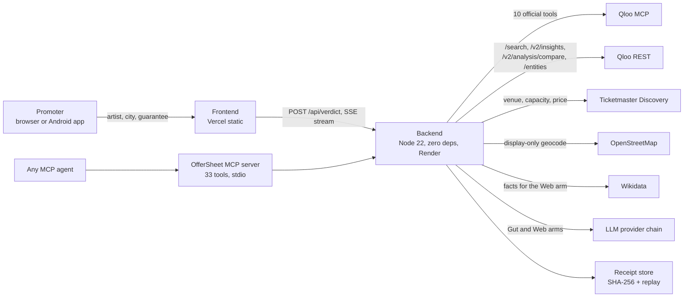

### From verdict to receipts

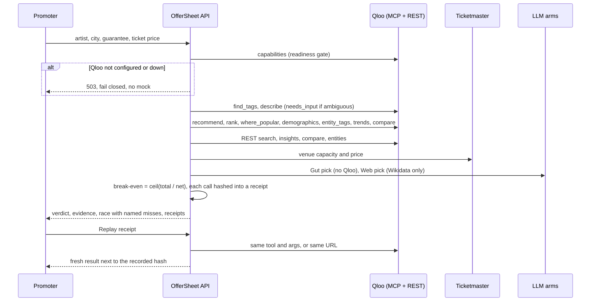

---

## 🎯 Qloo depth: 10 of 10 official MCP tools

Every official Qloo MCP tool drives a named feature. Each one is invoked when its precondition holds and receipted when it returns data. The live verdict above produced 9 receipts: 7 MCP tools and 2 REST legs.

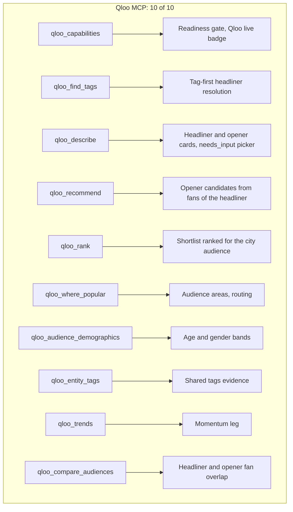

A REST receipt layer cross-checks the MCP legs: `/search`, `/v2/insights` (with `feature.explainability=true`), `/v2/analysis/compare` and `/entities`. Only artist, city and tag inputs are sent to Qloo. No names, emails or device IDs are ever sent: *aggregate audiences only, by design*.

## 🧰 OfferSheet MCP server: 33 tools

[`backend/mcp-server.js`](backend/mcp-server.js) is a zero-dependency stdio JSON-RPC 2.0 server (protocol `2024-11-05`) that exposes the whole product to any agent.

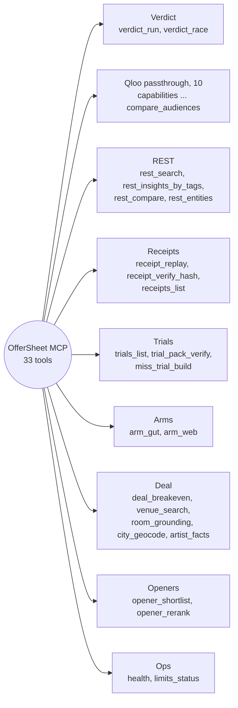

---

## 🧭 Tour by tab

| | |
|---|---|
| **01 Offer.** Artist, city, guarantee and ticket price, plus an optional venue, capacity, variable cost and fixed-cost stack (venue, production, marketing, other, sponsor offset). Blank means *not entered*, never zero. | 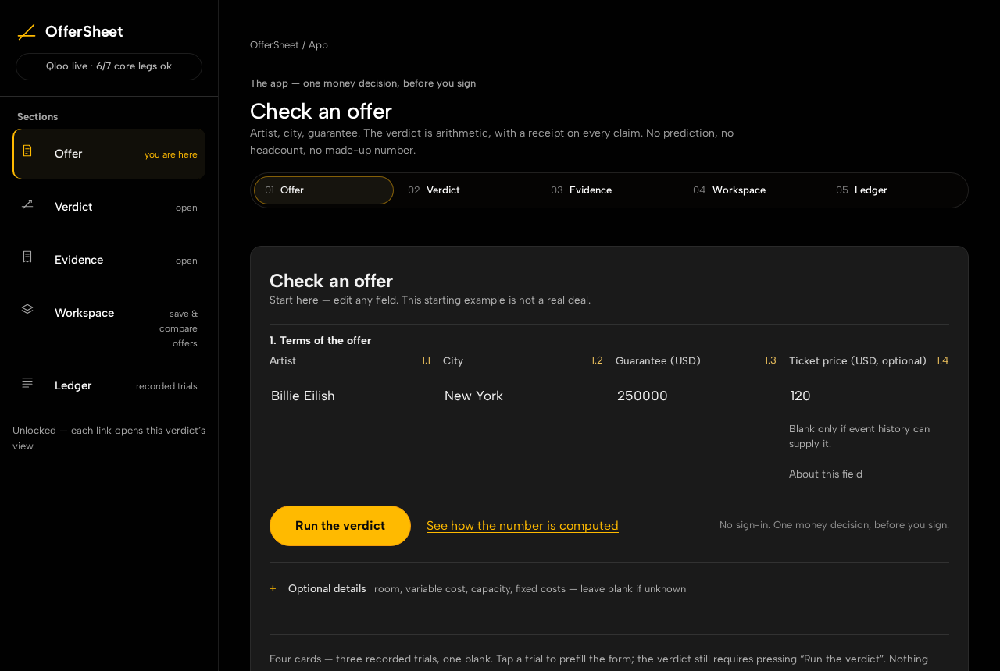 |
| **02 Verdict.** The break-even number first, then the before-you-sign checklist, the formula with every entered line, and the term sheet. The room capacity is labelled with its source. When the break-even is above a known capacity, the verdict reads *Cannot break even in this room at this guarantee.* | 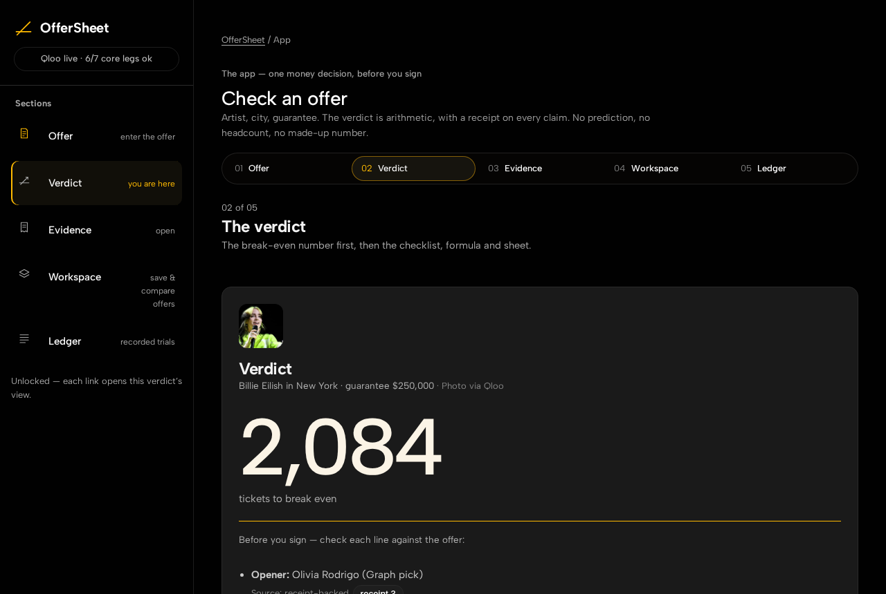 |
| **03 Evidence.** Audience areas, trend, the ranked opener shortlist, demographics, shared tags grouped by type, and fan overlap. Sources checked come with status pills (*ok*, *no data*, *retried*), and every call sits under one receipts row ("9 receipts · all replayable"). | 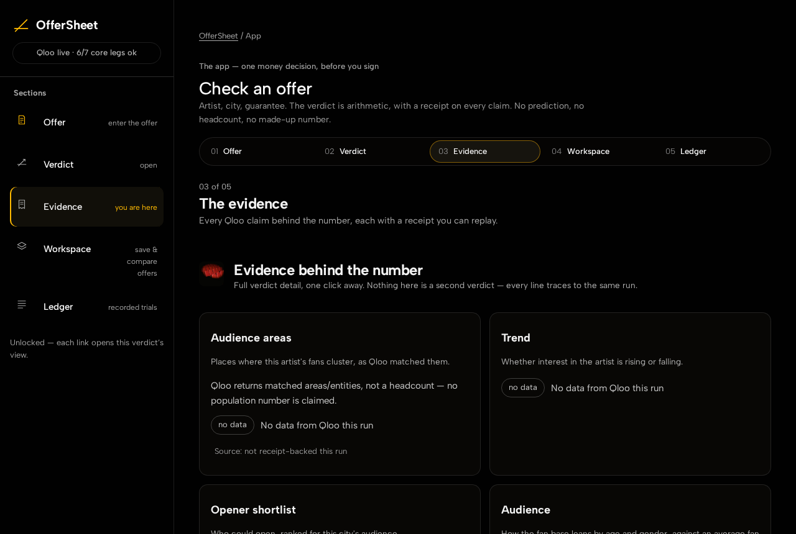 |
| **04 Workspace.** Save the verdict as a hash-verified workspace, then run a replacement act, a renegotiation, routing to other cities, a budget envelope, a comparison of up to 5 offers, and settlement. | 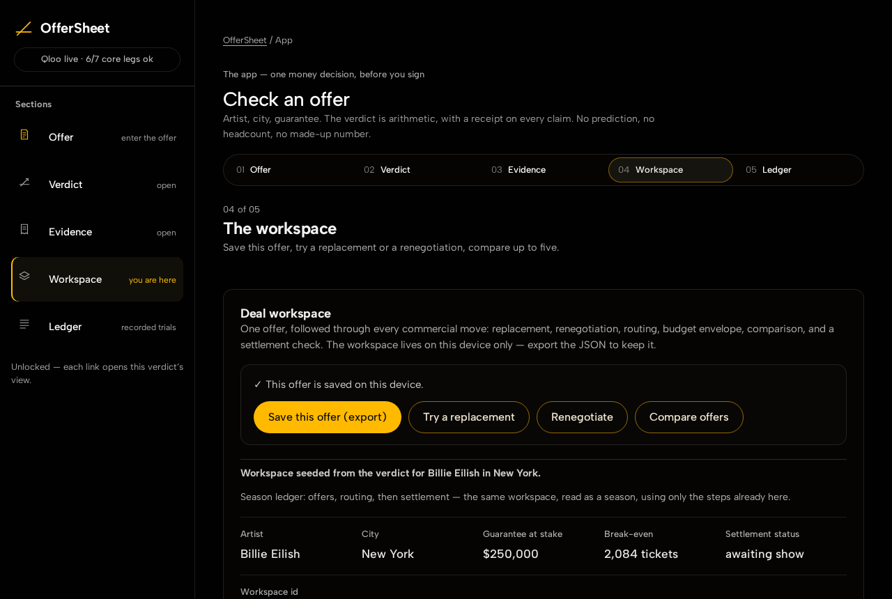 |
| **05 Ledger.** The Gut vs Graph tally across recorded trials: three pick tiles per trial with the recorded reasons, the named miss, a miss taxonomy, and *Use these inputs* to re-run any trial live. | 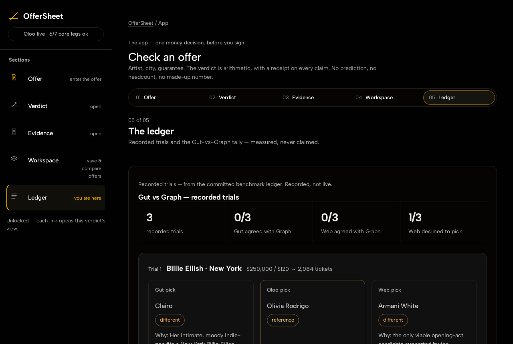 |

The landing page also links the Oracle, the tools catalog, the trial protocol and an offline page. The whole app meets WCAG AA contrast (every text node is at least 4.5:1) and scores 0 serious or critical axe issues on every tab, and both are re-checked at 1280 px and 390 px. Motion is switched off under `prefers-reduced-motion`.

---

## 📱 Android app

**[⬇ Download offersheet-release.apk](https://github.com/mohamedwael201193/OfferSheet/releases/download/android-app-v1.0.0/offersheet-release.apk)** (release [`android-app-v1.0.0`](https://github.com/mohamedwael201193/OfferSheet/releases/tag/android-app-v1.0.0), 295,972 bytes, signed release build). The app opens the live OfferSheet in a full-screen Android WebView, so it always runs the current deployment with the same receipts. The site is also an installable PWA ([`manifest.webmanifest`](frontend/manifest.webmanifest)).

<p align="center">
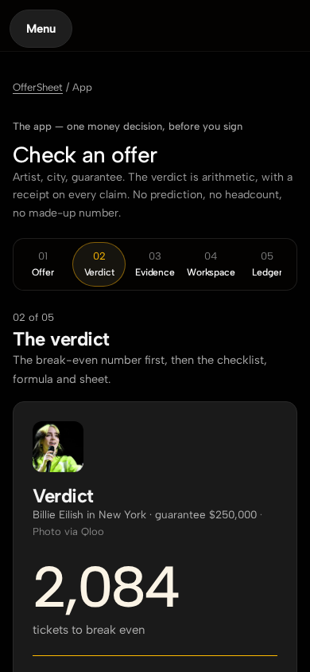
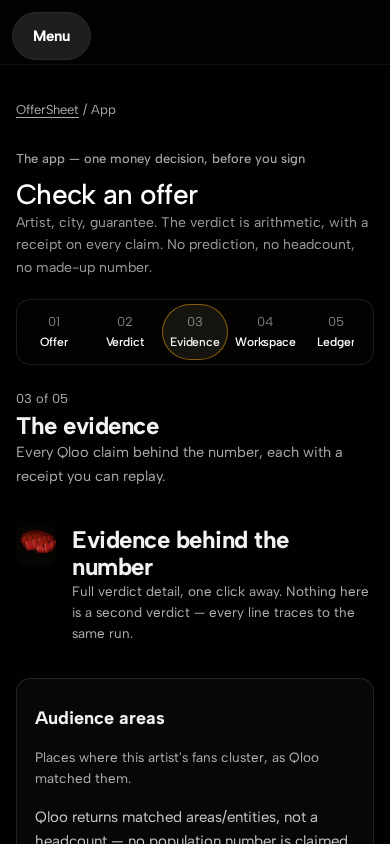
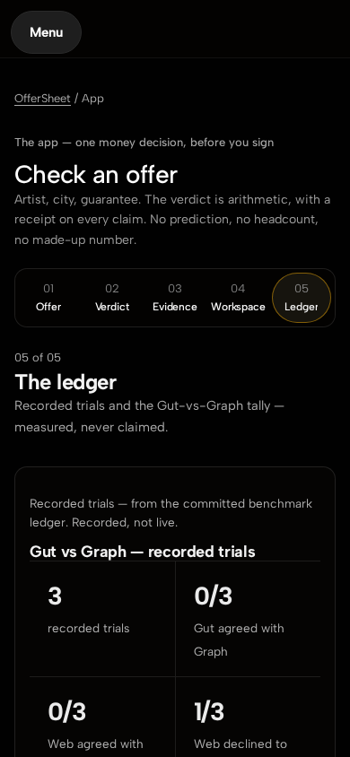
</p>

---

## 🛠 Run it locally

Requires Node ≥ 22.19. There are no runtime dependencies; `npm install` is only needed for the Playwright browser tests.

```bash
git clone https://github.com/mohamedwael201193/OfferSheet && cd OfferSheet
export QLOO_API_KEY=...            # required for live Qloo calls
export TICKETMASTER_API_KEY=...    # capacity and price leg
export LLM_BASE_URL=... LLM_API_KEY=... LLM_MODEL=...   # Gut and Web arms (optional)
node backend/server.js             # frontend + /api/* on http://localhost:3000
node --test test/*.test.js         # the suite
node backend/mcp-server.js         # MCP server on stdio, for any MCP client
```

| Variable | Purpose |
|---|---|
| `QLOO_API_KEY` | Qloo key. Without it, every live call fails closed with a visible 503. |
| `QLOO_BASE_URL`, `QLOO_MCP_COMMAND` | Optional overrides for the Qloo REST base and the MCP command. |
| `TICKETMASTER_API_KEY` | Venue capacity and price. Without it, capacity shows as *unknown*. |
| `LLM_BASE_URL`, `LLM_API_KEY`, `LLM_MODEL` | One OpenAI-compatible provider for the Gut and Web arms. |
| `AI_PRIMARY_PROVIDER`, `AI_FALLBACK_PROVIDERS` | Provider fallback chain (`<NAME>_BASE_URL`, `<NAME>_API_KEY`, `<NAME>_MODEL`). If every provider fails, the arm reads *unavailable*. |
| `MONTHLY_CALL_BUDGET`, `PER_VISITOR_DAILY_CAP`, `PER_RUN_CALL_CAP` | OfferSheet's own call guards (defaults 1500 / 20 / 40). |
| `PORT` | HTTP port (default 3000). |

Deployment: the frontend is served from `frontend/` on Vercel, and the backend runs on Render using [`render.yaml`](render.yaml).

---

## 🧪 Tech stack

| Layer | Choice |
|---|---|
| Backend | Node 22, `node:` built-ins only (zero runtime deps), SSE streaming |
| Taste intelligence | Qloo MCP (10 tools) + Qloo REST (4 endpoints) |
| Grounding | Ticketmaster Discovery, OpenStreetMap (display only), Wikidata (Web arm only) |
| Agents | OfferSheet MCP server (33 tools), Gut/Web LLM arms with a provider fallback chain |
| Frontend | Vanilla HTML/CSS/JS, GSAP (self-hosted), PWA, Android WebView app |
| Quality | `node:test` (610 tests), Playwright + axe-core in CI, GitHub Actions |
| Hosting | Vercel (frontend), Render (backend) |

## 📁 Project structure

```
backend/
  server.js            HTTP API: verdict, race, replay, rerank, workspace/*, bench, SSE stream
  mcp-server.js        OfferSheet MCP server (33 tools)
  src/
    pipeline.js        verdict orchestration across Qloo, Ticketmaster and the arms
    mcp.js  rest.js    Qloo MCP session (10-tool allowlist) and REST client (one 429 retry)
    receipts.js        SHA-256 receipts and replay
    breakeven.js       pure break-even arithmetic
    arms.js            Gut and Web arms, miss trial
    workspace.js       hash-verified workspace steps
    guards.js  ticketmaster.js  osm.js  wikidata.js  rerank.js  errors.js  config.js
frontend/              landing, app (5 tabs), oracle, tools, trial protocol, PWA, trial-pack.json
bench/results.json     committed recorded-trial ledger
test/                  77 test files (node:test)
e2e/                   Playwright browser checks
docs/screenshots/      README images
```

## 📄 License

[MIT](LICENSE). Open source and free to use, test and evaluate.
